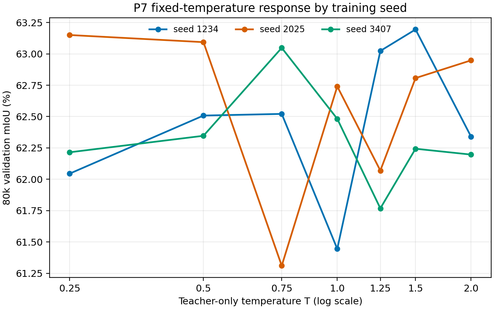
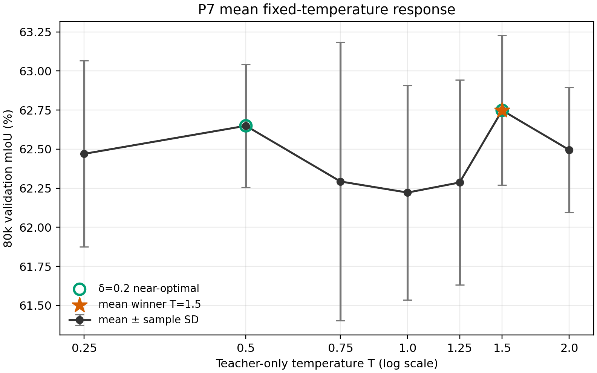
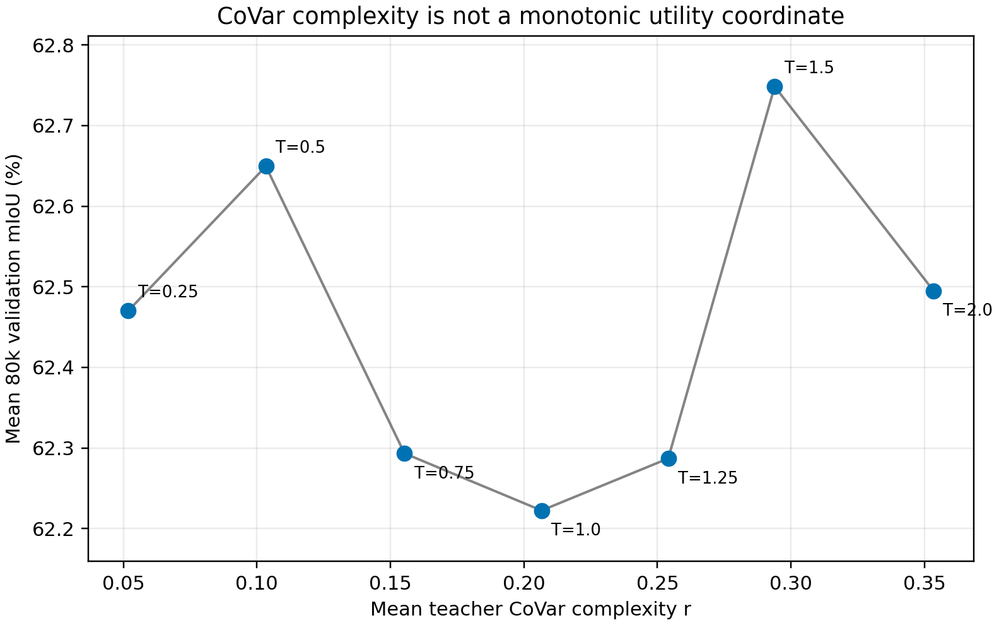

# P7A Finalization：固定温度响应的离线收尾

## 结论先行

- 本阶段未训练 student，也未新增温度点、seed 或自适应方法。
- T=0.25 的完整 CoVar 坐标为：r_c=0.005927，r_v=0.045944，r=0.051872。
- 七点平均 CoVar complexity 随 T 严格递增：True；mean mIoU 对 r 不单调：True。
- 样本均值赢家仍为 T=1.5；δ=0.2 pp 离散近优集合为 T=0.5, T=1.5。
- Leave-one-seed-out 的平均 selection regret 为 1.110379 pp。
- 结论：同一固定 teacher–student–protocol 内，CoVar complexity 的温度轨迹稳定，但基于少量训练轨迹识别出的效用最优温度不能稳定迁移到新的 seed。

## 1. 锁定协议与统计范围

- 教师、checkpoint、Pascal VOC val、预处理、有效像素定义和 CoVar 实现均与 P0 一致。
- 均值使用全部有效像素的全局 pixel-weighted reduction；有效像素数为 244,886,857。
- 分位数使用 P0 已锁定的确定性逐图无放回像素样本：每图最多 4,096 个，共 5,935,104 个像素；因此是高精度描述性样本分位数，不冒充全量精确分位数。
- 与 P0 六点均值复算的最大绝对差为 0.000e+00，一致性门禁通过。

## 2. 七点 CoVar—效用轨迹

| T | mean mIoU | sample SD | r_c mean | r_v mean | r mean |
|---:|---:|---:|---:|---:|---:|
| 0.25 | 62.470261 | 0.595144 | 0.005927 | 0.045944 | 0.051872 |
| 0.5 | 62.649466 | 0.392897 | 0.012145 | 0.091227 | 0.103372 |
| 0.75 | 62.293295 | 0.890913 | 0.018892 | 0.136383 | 0.155276 |
| 1.0 | 62.222435 | 0.685654 | 0.026652 | 0.179955 | 0.206608 |
| 1.25 | 62.286975 | 0.655489 | 0.036604 | 0.217428 | 0.254032 |
| 1.5 | 62.748429 | 0.478356 | 0.050836 | 0.243056 | 0.293892 |
| 2.0 | 62.495079 | 0.399020 | 0.102253 | 0.251133 | 0.353386 |

### r_c 像素分位数

| T | q10 | q25 | q50 | q75 | q90 |
|---:|---:|---:|---:|---:|---:|
| 0.25 | 0.000000 | 0.000000 | 0.000000 | 0.000000 | 0.000003 |
| 0.5 | 0.000000 | 0.000000 | 0.000000 | 0.000002 | 0.001634 |
| 0.75 | 0.000000 | 0.000001 | 0.000005 | 0.000191 | 0.014436 |
| 1.0 | 0.000011 | 0.000034 | 0.000160 | 0.001923 | 0.043804 |
| 1.25 | 0.000171 | 0.000407 | 0.001328 | 0.008314 | 0.087975 |
| 1.5 | 0.001090 | 0.002216 | 0.005711 | 0.023500 | 0.145184 |
| 2.0 | 0.011502 | 0.019259 | 0.037494 | 0.094346 | 0.295245 |

### r_v 像素分位数

| T | q10 | q25 | q50 | q75 | q90 |
|---:|---:|---:|---:|---:|---:|
| 0.25 | 0.000000 | 0.000000 | 0.000000 | 0.000000 | 0.000023 |
| 0.5 | 0.000000 | 0.000000 | 0.000000 | 0.000018 | 0.014433 |
| 0.75 | 0.000000 | 0.000002 | 0.000022 | 0.001353 | 0.120016 |
| 1.0 | 0.000012 | 0.000048 | 0.000414 | 0.010852 | 0.328988 |
| 1.25 | 0.000113 | 0.000364 | 0.002199 | 0.034798 | 0.562432 |
| 1.5 | 0.000483 | 0.001317 | 0.006246 | 0.069805 | 0.743717 |
| 2.0 | 0.002628 | 0.005821 | 0.019996 | 0.137403 | 0.853766 |

### r 像素分位数

| T | q10 | q25 | q50 | q75 | q90 |
|---:|---:|---:|---:|---:|---:|
| 0.25 | 0.000000 | 0.000000 | 0.000000 | 0.000000 | 0.000026 |
| 0.5 | 0.000000 | 0.000000 | 0.000000 | 0.000021 | 0.016094 |
| 0.75 | 0.000001 | 0.000002 | 0.000028 | 0.001552 | 0.134815 |
| 1.0 | 0.000025 | 0.000088 | 0.000590 | 0.012857 | 0.374485 |
| 1.25 | 0.000314 | 0.000835 | 0.003660 | 0.043540 | 0.654870 |
| 1.5 | 0.001733 | 0.003829 | 0.012491 | 0.094421 | 0.898340 |
| 2.0 | 0.015319 | 0.026921 | 0.060209 | 0.235205 | 1.167846 |

## 3. 最终图

图 C 直接显示：平均 r 随温度稳定上升，但 student utility 没有随 complexity 单调变化。

## 4. Leave-one-seed-out selection stability

| held-out seed | selection seeds | selected T | held-out best T | selection regret (pp) |
|---:|---|---:|---:|---:|
| 1234 | 2025, 3407 | 0.5 | 1.5 | 0.686676 |
| 2025 | 1234, 3407 | 0.75 | 0.25 | 1.839888 |
| 3407 | 1234, 2025 | 1.5 | 0.75 | 0.804573 |

平均 selection regret：1.110379 pp。

该分析是 post-hoc 描述性稳定性检查，不是严格泛化误差估计。它支持的有限结论是：即使模型对和协议固定，用两个 seed 选择的温度也可能无法迁移到第三条训练轨迹。

## 5. 证据边界与下一门禁

- 当前 VOC val 已参与温度响应刻画，不把本分析写成无偏最终测试结论。
- 七点仍是离散粗网格；本报告不声称存在连续空间的唯一最优温度。
- CoVar 在这里是稳定的 complexity coordinate，不是 utility objective。
- P7A 没有运行 CE-only。若继续训练，下一项最小门禁是与 P7 完全同协议的 CE-only 三 seed 80k 基线；第二模型对在其后。
- 未运行 T=0.125、T=0.375、T=3.0、Hard Teacher Target、P4a、CoVar-Match、shared temperature 或 T² compensation。
