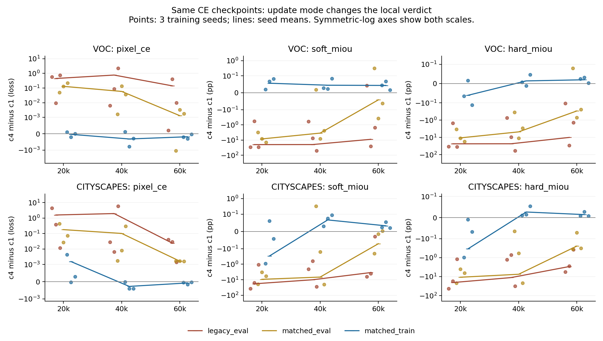
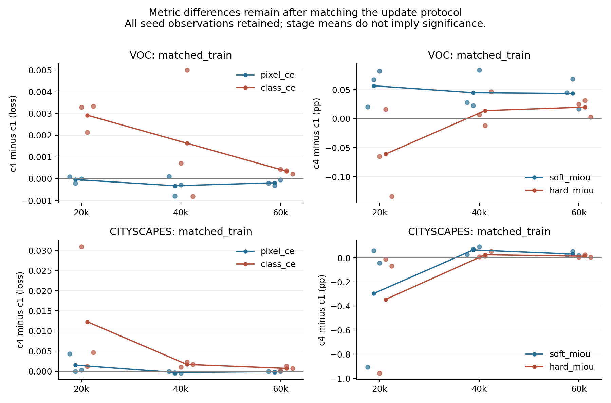

# 324 条诊断的复核、机制解释与论文主线调整

日期：2026-10-15。分析对象为新 Maker RTX 4090 队列 `P14_Utility_Maker_20261015_r3` 的全部正式一步 CE 起点诊断。原门槛及原始记录保持不变。本报告中的新解释属于事后分析，新实验安排见 [后续协议](../followup_protocol_20261015.md)。

## 1. 结论及证据规模

建议将论文问题调整为：密集预测中，局部蒸馏诊断在什么条件下能指导后续训练？当前最清楚的发现是，改变虚拟更新的训练状态会改变局部排序；单独换成 soft mIoU 没有显示出足够的选择优势。原定的 CE 与 soft mIoU 两种选择器直接进行 12 次完整训练，应继续暂停。

324 条记录均为有限、完成且经过状态恢复检查的正式结果，组成是 2 数据集 × 3 训练种子 × 3 检查点 × 3 更新模式 × 6 条件。只有 18 个数据集、种子、检查点组合，每个组合包含 18 个配对分支。训练种子仍只有三个，阶段、模式和候选条件都是重复测量。

重新核对了预期组合、路径与元数据、起点检查点哈希、监控像素及混淆矩阵、指标归约、同起点的全部 before 统计、更新流配对、梯度与范数对照。216 条继承结果与父清单逐字节一致，另 108 条属于 r3 新结果。由充分统计量复算四种指标，最大误差为 2.665×10⁻¹⁵。原队列状态为 `SCIENTIFIC_STOP`，KD 起点诊断、128 步 rollout 和选择器完整训练均未执行。

工程上的 PASS 表示分支完成且数值有限，不表示该条件有收益。部分 eval 分支虽然有限，一步后的 hard mIoU 已严重下降。例如 VOC seed3407/40k 的 legacy c4−c1 为 −59.548 pp；Cityscapes seed1234/20k 为 −43.408 pp。这类极端局部扰动不应直接解释成长期蒸馏的损害。

## 2. 门槛失败具体否定了什么

原门槛检查 matched_train 模式下，Shared c4−c1 的一步 pixel CE 三种子均值，要求每套数据至少 2/3 个阶段为正。正号代表 c4 的局部 CE 更差。它检验旧局部反转现象的可迁移性，是计算资源分配规则，不是显著性检验，也不是新方法的最终 mIoU 达标线。

| 数据集 | 20k：均值 ± 种子 SD | 40k：均值 ± 种子 SD | 60k：均值 ± 种子 SD | 正均值阶段 |
|---|---:|---:|---:|---:|
| VOC | −0.0000371 ± 0.0001575 | −0.0003209 ± 0.0004537 | −0.0001854 ± 0.0001341 | 0/3 |
| Cityscapes | +0.0015396 ± 0.0024453 | −0.0002755 ± 0.0002267 | −0.0000749 ± 0.0000694 | 1/3 |

两套数据都失败。Cityscapes 20k 均值由 seed1234 的 +0.0043565 明显拉高，另外两个种子为 −0.0000365、+0.0002988。跨三个阶段先在种子内平均，Cityscapes 三种子的 CE 差为 +0.0014332、−0.0001973、−0.0000468，均值和中位数方向不同。不能靠汇总 9 个点或 324 条分支放大统计把握。

失败限制的是“旧诊断排序能在训练状态匹配后保持”这一前提。它不推翻原来 30 次完整训练：Shared c4−c1 在 VOC 的最终 mIoU 均值为 −1.339 pp，在 Cityscapes 为 +0.739 pp，两套数据各自三个种子方向一致。那些是另一硬件队列、从训练初始状态执行到 80k 的结果；当前是 CE 中间起点的一步变化。二者不能当作同起点的长期反事实。

原门槛保持失败；把正号改为负号，换指标，或改为只要求 Cityscapes 通过，都会是看过结果后的新假设，不能据此宣称原协议成功。

## 3. 最大变化发生在更新状态

下表仍为 Shared c4−c1 的 pixel CE，均值来自三个训练种子。

| 数据集 | 虚拟更新模式 | 20k | 40k | 60k |
|---|---|---:|---:|---:|
| VOC | legacy_eval，batch2 | +0.447186 | +0.766421 | +0.140938 |
| VOC | matched_eval，batch16 | +0.130693 | +0.058800 | +0.001306 |
| VOC | matched_train，batch16 | −0.000037 | −0.000321 | −0.000185 |
| Cityscapes | legacy_eval，batch2 | +1.582377 | +1.960136 | +0.023837 |
| Cityscapes | matched_eval，batch8 | +0.179124 | +0.101384 | +0.001632 |
| Cityscapes | matched_train，batch8 | +0.001540 | −0.000276 | −0.000075 |

legacy 模式 18/18 个组合的 CE 都偏好 c1。完整批次的 eval 模式仍有 17/18 偏好 c1；训练模式只剩 5/18，另 13/18 偏好 c4。在输入图像与增强相同的 matched_eval→matched_train 对照中，12/18 个 CE 对比改变符号，VOC 5/9、Cityscapes 7/9。这是描述性计数，不是 18 次独立实验。

hard mIoU 也随更新状态变化，不能把原 eval 诊断的问题全部交给 CE 指标解释。

| 数据集 | 模式 | 20k hard mIoU 差，pp | 40k | 60k |
|---|---|---:|---:|---:|
| VOC | matched_eval | −10.614 | −4.779 | −0.295 |
| VOC | matched_train | −0.061 | +0.014 | +0.020 |
| Cityscapes | matched_eval | −10.748 | −7.491 | −0.245 |
| Cityscapes | matched_train | −0.344 | +0.026 | +0.014 |



图中每个点对应训练种子，线为三种子均值，纵轴使用对称对数尺度以显示不同量级。CE 越低越好，IoU 越高越好；阶段不是新增独立种子。

目前能归因于训练状态这个整体干预，尚不能归因于 BN 单独一个因素。模式切换同时改变 BN 前向所用统计量、反向梯度、running buffers 和 dropout。legacy→matched_eval 还改变图像数量及子集，不能单独当作纯 batch size 效应。

一个容易误判的细节：一步分支在更新参数前只执行一次学生前向。同一训练模式、同一输入和随机流下，改变 KD 系数并不会在该前向之前改变权重，因此在精确运算下，各候选得到相同的 BN buffer 更新。当前没有保存分支后的 buffer 张量来独立复核这一推论，CUDA 前向也有微小数值差异，但代码结构已经说明，“c4 多更新了 BN”不是成立的解释。需要拆分前向归一化、dropout、参数更新和监控时采用的 buffer。

## 4. 指标差异存在，但 soft mIoU 目前不能承担主方法

训练模式下，Shared c4−c1 的四指标均值如下。

| 数据集 | 阶段 | pixel CE | class CE | soft mIoU，pp | hard mIoU，pp |
|---|---:|---:|---:|---:|---:|
| VOC | 20k | −0.000037 | +0.002923 | +0.0565 | −0.0610 |
| VOC | 40k | −0.000321 | +0.001634 | +0.0447 | +0.0139 |
| VOC | 60k | −0.000185 | +0.000347 | +0.0434 | +0.0198 |
| Cityscapes | 20k | +0.001540 | +0.012297 | −0.2952 | −0.3443 |
| Cityscapes | 40k | −0.000276 | +0.001718 | +0.0665 | +0.0265 |
| Cityscapes | 60k | −0.000075 | +0.000751 | +0.0323 | +0.0142 |

pixel CE 与 hard mIoU 对 c4/c1 的优劣判断在 15/18 个组合中一致，pixel CE 与 soft mIoU 也在 15/18 一致。soft 与 hard 在 4/18 个组合中不一致，其中 VOC 为 3/9。VOC 的 soft mIoU 在全部 9 个组合中偏好 c4，hard mIoU 只有 6/9 同向；已有 VOC 完整训练则三个种子都由 c4 降低最终 mIoU。

把已观测的一步分数用于 c∈{0,1,4} 的离线选择，采用原协议的 10⁻⁶ 数值平局规则，会得到下表。这里没有运行选择器训练，也不能用它证明最终预测能力。

| 数据集、matched_train | pixel CE 选 c0/c1/c4 | class CE 选 c0/c1/c4 | soft mIoU 选 c0/c1/c4 | hard mIoU 选 c0/c1/c4 |
|---|---|---|---|---|
| VOC，9 个组合 | 1 / 2 / 6 | 8 / 0 / 1 | 0 / 0 / 9 | 3 / 0 / 6 |
| Cityscapes，9 个组合 | 2 / 0 / 7 | 9 / 0 / 0 | 2 / 0 / 7 | 2 / 1 / 6 |

Cityscapes 的 pixel CE 和 soft mIoU 在全部 9 个组合中选择相同，不只是选中次数相同。原方法设想的唯一改动若是这两个指标互换，当前一步观测没有显示可利用的选择差异。128 步可能不同，但必须另行验证。VOC 的 soft mIoU 总选 c4，也提示它可能保留错误的长期偏好。不能因为名称包含 IoU，就把这个平滑概率指标等同于 argmax 后的 hard mIoU。



类别加权差异仍值得作为一个机制对照。VOC 监控池背景占 68.19% 有效像素。对种子和三个阶段作描述性平均，背景的 CE 变化贡献 −0.000635，其余类别按像素加权合计 +0.000454，得到总体 −0.000181；前景类别的 class CE 平均变化为 +0.001763。c4 可以降低占多数的背景 CE，同时提高平均前景 CE。

Cityscapes 监控池 road、building、vegetation 合计占 75.65%。40k 阶段三类对 pixel CE 的贡献为 −0.000427，其他类别合计 +0.000151，总体仍为负。这解释了 pixel CE 与 class CE 的某些方向差异。class CE 却在所有 9 个 Cityscapes 组合中选择不蒸馏，同样不能凭类别均衡就认定它更能预测长期收益。

Cityscapes train、bus 的一步 hard IoU 跨阶段平均变化分别约 −0.895、−0.543 pp，而旧完整训练中 Shared c4 的这些类别增益明显。这里混合了阶段与轨迹、监控训练池与验证集、硬件队列，不能作因果证明，但足以说明需要实际测量时间跨度，不能把一步的类别分解直接外推到 80k。

## 5. 梯度对照揭示的边界

六条件没有被只保留 Shared 的主对比所替代。以下列出所有 KD 条件相对同模式 CE-only 更新的变化，均为 matched_train；先在种子内平均三个阶段，再取三种子均值，仅描述已观测的局部行为。

| 数据集 | 条件 | pixel CE 变化 | soft mIoU 变化，pp | hard mIoU 变化，pp |
|---|---|---:|---:|---:|
| VOC | Shared c1 | −0.000089 | +0.01910 | +0.00096 |
| VOC | Shared c4 | −0.000270 | +0.06728 | −0.00813 |
| VOC | Teacher c1 | +0.000070 | −0.00831 | +0.00538 |
| VOC | Teacher c4 | +0.000422 | −0.04871 | −0.00033 |
| VOC | Shared_norm | −0.000115 | +0.02395 | +0.00116 |
| Cityscapes | Shared c1 | +0.000053 | −0.00925 | −0.01851 |
| Cityscapes | Shared c4 | +0.000450 | −0.07472 | −0.11970 |
| Cityscapes | Teacher c1 | +0.000289 | −0.08593 | −0.06054 |
| Cityscapes | Teacher c4 | +0.002286 | −0.46918 | −0.36252 |
| Cityscapes | Shared_norm | +0.000164 | −0.03106 | −0.04606 |

Teacher c4 在 Cityscapes 的这一局部均值较差，却是旧 80k 主表的最高均值。这再次要求检查时间跨度与起点轨迹，不能据此删除强最终基线。VOC 的许多 hard mIoU 差很小，不能从小数位上的赢家推出实用效果。对于每个起点内全部六候选的排序，pixel CE 与 hard mIoU 的方向统一后 Spearman 相关在 matched_train 中的描述性平均为 VOC 0.314、Cityscapes 0.886；两者的指标一致性也不相同。这不是跨 54 个组合的独立相关性检验。

下表为 9 个种子、阶段组合的描述性中位数。

| 数据集 | 更新模式 | Shared c4 的 KD/CE 梯度范数比 | Shared 的 KD 与当前批 CE 梯度余弦 |
|---|---|---:|---:|
| VOC | matched_eval | 3.176 | 0.719 |
| VOC | matched_train | 2.958 | 0.803 |
| Cityscapes | matched_eval | 4.718 | 0.626 |
| Cityscapes | matched_train | 3.783 | 0.733 |

VOC 的范数比中位数只从 3.176 变为 2.958，局部监控变化却跨越很大量级。总体范数不能独自解释这个现象；参数方向、各层相对更新、BN 对函数扰动的影响和步长曲率仍需测量。Shared 的 KD 与当前批 CE 在这些完整批次分支中的余弦均为正，但当前批对齐不等于监控目标对齐，也不保证有限步长下损失下降。

Shared_norm 确实完成了其设计的范数匹配，跨分支数值复核最大相对误差为 2.674×10⁻⁷。它把 Shared 的 KD 范数匹配到 Teacher c1，而不是把整个 SGD 更新、各层方向、动量或函数变化匹配。训练模式下匹配系数中位数为 VOC 1.301、Cityscapes 1.614，并非固定 c4。Teacher c1 和 Shared_norm 的监控表现仍不同，不能把温度放置差异简化成一个通用的 T² 倍率。

在有效 native-grid 像素上，Shared 的 logit 梯度正比于 `(softmax(z/2)−softmax(t/2))/2`，Teacher-only 则正比于 `softmax(z)−softmax(t/2)`，两者的学生分布也变了。显式 c 和额外 T² 必须继续区分。

对同一模式的一步 SGD，可以把候选写成 θc=θ−η(d+c·gKD)，其中 d 包含 CE、已保存动量和 weight decay。局部监控差异依赖监控目标梯度与 gKD 的对齐、有限步长曲率，以及监控时的 BN buffers；现存 `kd_ce_cosine` 测的是更新批 CE 的梯度。后续应测监控方向导数或受控步长响应，而不是用这个余弦直接宣称蒸馏有益或冲突。

恢复状态也不等于位级确定前向。候选之间更新前 CE 的最大跨度为 1.788×10⁻⁷，配对梯度统计的最大相对差为 3.072×10⁻⁶。这个量级不能直接转换为一步 hard mIoU 的误差上界。当前没有同候选、同输入的独立重复终点，因此接近零的方向必须先经过 replay 误差测量。

## 6. 推荐的 CVPR 主线

暂定问题式标题：**Can Local Probes Select Distillation Strength for Dense Prediction?** 中文工作主题是“密集预测蒸馏中，局部效用诊断的适用条件与长期决策”。

论文可以从已完成的两套温度放置、强度因子实验引出问题：固定 KD 强度的长期效果依赖训练设定，而本项目的短期局部探针给出了不稳定的建议。随后通过相同输入、相同完整状态的控制，拆解归一化和随机训练状态如何改变诊断；再检验诊断是否能预测同一起点分叉后的实际训练收益。只有最后一环成立，才增加一个允许“证据不一致时保留原系数”的简单选择规则。

目前可主张的是：这两个固定协议下的一步局部排序对训练状态敏感，metric substitution 未显示普遍修复。尚不能主张 BN 单独造成原反转，不能声称匹配状态后一定预测长期结果，不能声称新的选择器有效，也不能把原 CoVar 自适应方法写成已经验证。

有三条需要放弃的预设：Teacher-only 普遍优于 Shared；系数大必然有害；只要使用 class-balanced 或 soft-IoU 指标就能修复蒸馏选择。这些都得不到当前证据支持。

这条主线比继续扩温度网格更有解释空间，但仅展示 BN/train-eval 影响还不足以支撑一篇有说服力的 CVPR 投稿。旧 eval 探针是本项目采用的工具，目前没有证据说明主流 KD 方法普遍采用这种设定；修正自己工具的问题不能单独当作领域创新。论文更有价值的证据应来自训练状态已匹配之后，局部信号是否仍会因起点、时间跨度或类别变化而失去预测能力，以及这种失效能否被提前识别。必须补齐可重复的因果拆分、同起点的较长分叉训练，以及不同归一化架构的验证。若长期预测检验失败，应将结论收敛为诊断适用边界，停止方法收益主张。

相关研究已经覆盖大量相邻概念。[Beyer 等，CVPR 2022](https://arxiv.org/abs/2106.05237)研究了影响蒸馏的隐含训练设计；[Logit Standardization，CVPR 2024](https://arxiv.org/abs/2403.01427)和 [Scale Decoupled Distillation](https://arxiv.org/abs/2403.13512)处理 logit 尺度与蒸馏关系；[Ren 等，ICML 2018](https://proceedings.mlr.press/v80/ren18a.html)已用虚拟更新及外部损失学习权重。这里需要证明的增量应是密集预测诊断的失效条件、可验证的决策校准及其跨架构适用范围。该针对性检索不能替代投稿前的完整相关工作审查。

## 7. 产物与执行边界

全部原始科学 JSON 及原注册链保存于 [只读证据包](evidence.tar.gz)，SHA256 为 `d0cde8c530de3e3986695a3692d328fcea9781f0f3bdc2745fc1e9690570a63f`。包内不含数据图片、模型权重或连接凭证。

[复核与汇总](summary.json)、[全部种子阶段差值](case_contrasts.csv)、[阶段均值及种子 SD](stage_contrasts.csv)、[种子内阶段均值](seed_stage_averages.csv)、[逐类变化](matched_train_per_class.csv)、[候选排名相关](candidate_rank_correlations.csv)和 [离线选择](one_step_choices.csv)均由 [分析脚本](../../../tools/analyze_diagnostics_324.py)生成。排名相关按每个组合内六候选计算，只作描述，不将候选数当作样本量。

复现时将证据包解压至独立目录，使用 Python、NumPy、SciPy 和 Matplotlib 运行：

```bash
python tools/analyze_diagnostics_324.py --raw /path/to/extracted/evidence --out /path/to/analysis
```

本次统计后处理在本机 CPU 完成，没有在本机或旧入口执行新的模型实验。后续所有 GPU 实验限定新 Maker 服务器。旧入口仅保留检查点读取和续传职责。新方案处于具体计划阶段，尚未启动新诊断或新完整训练，也未通过重启旧队列绕过失败门槛。
