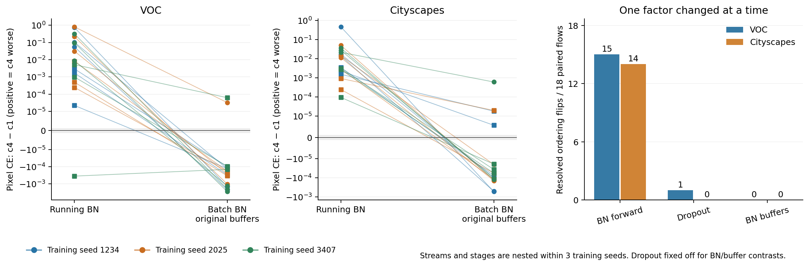
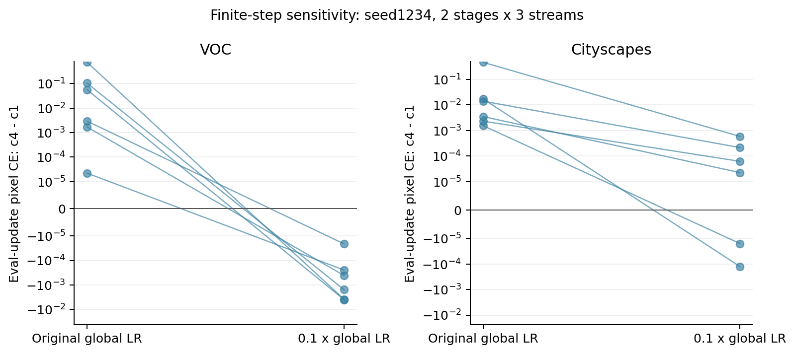

# P1 完整结果与 CVPR 主线判断

日期：2026-10-16。P1 已在北京时间11:26完成，两个数据集各456个端点，共912个，576次优化器更新和72次仅更新BN统计的前向全部通过。P0/P1 队列总墙钟耗时12.01小时。分析使用完整结果，覆盖3个既有训练种子、20k/60k两个阶段及每个种子内3条新更新流。18个起点流对比不是18个独立训练种子；P1的起点均为CE训练轨迹。

结论是支持进入P2，主线应围绕训练状态和有限步长下局部蒸馏诊断的可信度展开。P1已识别出可干预、跨三个训练种子重复的BN前向效应，并表明eval一步探针对全局学习率敏感。是否能据此选出更好的后续训练系数，要由同起点真实续训验证。单独修正BN模式，或单独把CE换成soft mIoU，尚不能构成完整的选择方法结论。

## BN 前向是主要排序干预

定义D为B池上更新后pixel CE(c4)减去pixel CE(c1)，D大于零表示c4比c1差。全部监控均用eval前向、256张原生分辨率训练图像和CPU float64充分统计量。

| 单独改变的因素 | VOC的可分辨排序翻转 | Cityscapes的可分辨排序翻转 |
|---|---:|---:|
| BN running改batch，Dropout关，监控装回原BN缓冲 | 15/18 | 14/18 |
| BN running改batch，Dropout开，监控装回原BN缓冲 | 14/18 | 14/18 |
| 仅开Dropout，BN固定running | 1/18 | 0/18 |
| 仅开Dropout，BN固定batch且监控装回原BN缓冲 | 0/18 | 0/18 |
| 仅将原BN缓冲换成更新后缓冲，Dropout关或开 | 各0/18 | 各0/18 |

翻转要求前后D位于相应P0数值带的相反两侧；进入数值带不算翻转。BN前向干预在两个数据集的三个训练种子内，平均影响方向均为降低D。Dropout关闭时，平均D在VOC从0.133258降至−0.000695，在Cityscapes从0.037420降至−0.0000752。该均值包含早期大幅值响应，不能只看均值而忽略阶段和流的分布。

图中每条线为配对更新流，颜色对应训练种子，圆点为20k，方点为60k。前两图均关闭Dropout并在监控时使用原BN缓冲，纵轴采用对称对数尺度。右图的Dropout对照固定running BN，缓冲对照固定batch BN且关闭Dropout。

参数相同、仅替换BN缓冲的对照没有重现主排序翻转。因此主要现象来自更新前向中归一化方式改变了参数更新，而不是把新BN统计带进监控这一单独因素。缓冲仍影响绝对分数及对比幅值，不能称其没有作用。这里识别的是完整模型BN干预的作用，尚未定位到某一层或证明全由梯度范数解释。

## 匹配训练状态后仍存在种子差异

下表先在每个训练种子内对两个阶段和三条流取平均。eval为running BN且关闭Dropout，train为batch BN、开启Dropout并使用实际更新后缓冲。

| 数据集 | 训练种子 | eval的D | train的D |
|---|---:|---:|---:|
| VOC | 1234 | 0.150456 | −0.000741 |
| VOC | 2025 | 0.178249 | −0.000382 |
| VOC | 3407 | 0.071069 | −0.001038 |
| Cityscapes | 1234 | 0.083682 | −0.000215 |
| Cityscapes | 2025 | 0.013279 | −0.0000895 |
| Cityscapes | 3407 | 0.015301 | 0.0000412 |

训练态并不保证所有起点都偏好c4。Cityscapes seed3407的平均D仍为正。按流计，训练态c4相对c1在VOC有16/18个明确改善，在Cityscapes有14/18个明确改善；剩余流包含退步和数值平局。需要保留这些边界，不能把均值变化写成普遍改善。

## 有限步长贡献了另一个机制

步长、清零动量、方向差分及范数控制仅覆盖seed1234的两个阶段和三条流，每套数据6个配对对比，属于机制控制。

| 控制 | VOC | Cityscapes |
|---|---|---|
| eval全局LR降至0.1倍 | 6/6从c4较差变为c4较好；平均D从0.150456变为−0.001677 | 2/6翻转，其余4/6仍为正；平均D从0.083682降至0.000123 |
| eval清零原动量 | 5/6仍为正，1/6进入数值带 | 6/6仍为正 |
| 固定BN缓冲的KD方向差分 | 4/6在CE更新点附近的CE方向斜率为负，但完整c4−c1对比为正 | 对应情况为2/6 |

方向差分在CE更新后的参数附近，以系数扰动±0.1形成中心差分；监控装回原BN缓冲。它与c1到c4的大跨度响应不必同号。这支持有限步长和曲率会改变诊断排序的解释。0.1倍全局LR同时改变CE、KD、动量和weight decay的总步幅，不能将它等同于仅降低KD系数。清零动量没有系统地移除eval现象，因此原动量不是充分解释。

P1记录的梯度范数及范数匹配对照也不足以将Teacher与Shared温度放置视为同一方向的缩放。例如VOC的6个训练态锚点流中，Shared_norm相对同态CE分支的pixel CE均下降，而Teacher c1仅2个明确下降、3个上升、1个处于数值带内。该控制只有一个训练种子，不能扩展成跨种子的温度机制结论。

## 结果不支持只换指标的主线

在匹配训练态下，CE与soft mIoU对c0/c1/c4的选择分歧，在数值平局带规则下为VOC 3/18、Cityscapes 2/18。大部分建议兼容。VOC的train pixel CE有16/18选择c4，soft mIoU有17/18选择c4；Cityscapes分别为14/18和16/18，另有CE平局。

因此当前结果没有确立soft mIoU相对CE的普遍选择优势。既有80k VOC结果中的Shared c4较弱可作为动机，但它们来自不同轨迹及硬件cohort，不能与当前CE起点的一步分数直接拼接成预测正确率。P2的同检查点分叉用于建立这条缺失的证据链。

## 建议的论文问题和证据顺序

建议问题为：局部蒸馏探针在什么训练状态和时间跨度下，能够可靠预测同起点的后续收益。可用工作标题为“When Are Local Distillation Probes Trustworthy for Dense Prediction”。

第一层证据是可分辨性与机制：P0将数值噪声与候选差异分开，P1在完整batch中分离BN前向、Dropout、缓冲、动量与步长。第二层必须是预测效度：从同一CE或KD起点比较一步与较长探针，冻结选择后再看真实2k分叉的完整验证集mIoU，以选择regret评价。第三层是适用范围：后续跨架构控制区分BN密集网络与不同归一化实现。最后才以冻结规则、新种子和强固定参照验证完整训练价值。

仅发现BN影响KD已有先例。相关研究分别讨论了持续学习中的师生BN统计分歧，以及共享温度带来的logit尺度约束：[Adapt Your Teacher](https://openaccess.thecvf.com/content/WACV2024/papers/Szatkowski_Adapt_Your_Teacher_Improving_Knowledge_Distillation_for_Exemplar-Free_Continual_Learning_WACV_2024_paper.pdf)、[Logit Standardization in Knowledge Distillation](https://arxiv.org/abs/2403.01427)。这些工作并不等于本项目的同起点探针预测问题，但意味着论文不能只以“BN会影响蒸馏”作为新贡献。

我的判断是P1满足继续投入P2的条件，也把主线从指标替换推进到可检验的诊断有效性。若P2中匹配状态和较长跨度仍不能降低选择regret，就应把结论收窄到局部诊断失效及边界；不能用击败eval弱对照来代替对train CE强对照的改进。

## P2实施和预算口径

[P2执行协议](../p2_execution_20261016.md)固定12个20k起点、3个探针流和独立的实际分叉流。包含144条128步训练态rollout、108次eval一步更新，共540个探针端点；随后冻结四种规则的选择并持久化，才启动36条2k分叉和36次完整验证。总计90,540次优化器更新，另外12次B池起点评分。该队列不启动P3/P4或80k轨迹。

P1实际的256图评分中位耗时为VOC19.36秒、Cityscapes272.26秒，累计评分设备任务时间分别2.61及34.23小时；这些含CPU统计和共享资源等待，不能当作纯CUDA算力时间。P0/P1总墙钟为12.01小时。P2训练和评分使用新服务器的四卡短基准重新估计，官方验证耗时在盲选完成前只能按图像数和监控成本给区间，不提前读取验证分数。

## 可复核文件

分析表见`contrasts.csv`、`seed_stage_contrasts.csv`、`interventions.csv`、`buffer_effects.csv`、`controls.csv`、`gradient_summary.csv`、`directions.csv`及`choices.csv`。`summary.json`记录完整覆盖、配对干预和耗时，`additional_findings.json`保留上述步长和指标选择统计。

P15注册SHA为`5ee9c365f701c17cd47c874b34372a7d4fbe7c345ced9f223d71f7513d156caf`。分析原始快照SHA为`110f66fbfb10d1ff751dd9a35e93bf876eef66e479e7b850c0c5570ef101f064`，采集时间为2026-10-16 11:33北京时间。原始科学记录及注册已在Maker持久存储归档，源检查点未覆盖，已有保活程序未收到本队列的停止信号。
